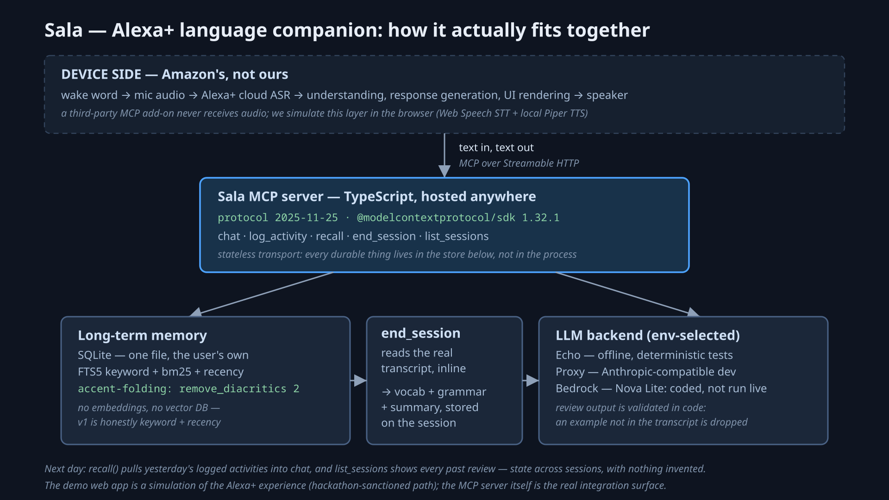

# Sala (working name) — the living-room language companion

Amazon "Build, Ship, Shape" Developer Hackathon entry (`amazonappdev2026`), **Alexa+ track**. MIT licensed.

An Alexa+ companion MCP server that acts as a living-room friend: it remembers your daily
activities and past conversations, sustains everyday chat in whatever language you're learning
using that personal context, and ends each session with grammar/vocabulary review lists
generated from what you actually said. The review cards quote your own sentences, verbatim.

**Status: A1 (server core) + A2 (web sim + voice mode) + A3 (submission polish) COMPLETE.
280/280 offline tests green (re-verified in a network namespace 10-23), demo proven end-to-end in English, French and German over a live
Anthropic-compatible backend (review extraction on the LLM path in all three, verbatim integrity
5/5 · 5/5 · 7/7), review in 5-10 s, and cross-session mistake recurrence proven on real closed
sessions. German voice ready.** Full spec: [SPEC.md](SPEC.md).
QA evidence: [docs/a2-qa.md](docs/a2-qa.md). Submission checklist: [docs/SUBMISSION.md](docs/SUBMISSION.md).

## What it does

- **Chats in your target language** (EN/DE/FR in the demo picker, anything via the `targetLanguage`
  param) as a friend, not a tutor. Comprehensible input, at most one gentle recast correction per
  exchange, never a lecture.
- **Remembers your life.** `log_activity` stores what you did. `chat` genuinely retrieves stored
  material (FTS5 keyword + recency) and weaves it in only when relevant. The sim shows a
  "remembered" badge **only** when the server flag `memoryReferenced` is true.
- **Never fabricates.** Ask about something that was never logged and Sala says it has nothing
  stored. Review items are extracted from the actual transcript, and every model-proposed example
  is validated in code for verbatim containment before it can appear.
- **Ends sessions with a review** (`end_session`): 4-6 vocabulary items and 1-2 grammar points,
  each carrying your own sentence as the example, plus a summary. This is the product's money shot.
- **Changes language when you ask.** Mid-session, out loud: "let's speak French." The server
  recognises the request (or a capable client calls `set_language` directly), the persona, the
  review at the end and the device's voice all follow, and the conversation is never restarted.
- **Speaks and listens** in the web sim (half-duplex turn taking, browser Web Speech API, local
  Piper neural TTS fallback on machines with no browser voices).

## Architecture: where the real Alexa+ boundary is



The one-frame version of everything below (also as [`architecture.svg`](docs/assets/architecture.svg)
for video use, and [`docs/architecture.mmd`](docs/architecture.mmd) as the editable source). No vector
database and no audio path in it, because neither exists — see the two sections it summarises.

Verified 2026-10-20 from the official MCP Toolkit docs
(developer.amazon.com/docs/alexaplus/add-ons/mcp-toolkit-overview.html):

> "Alexa+ acts as the MCP client. You return standard MCP responses, and Alexa+ handles natural
> language understanding, response generation, and user interface (UI) rendering."
>
> "Alexa+ for Builders supports the 2025-11-25 version of the MCP specification."

That quote decides the whole shape of this project:

```
   REAL Alexa+ (production)                 THIS REPO (hackathon demo)
   ────────────────────────                 ──────────────────────────
   Echo device ──audio──▶ Amazon cloud
                          (ASR → text)
                          Alexa+ = MCP client ──MCP──▶  ┌─────────────────────────────┐
                          (NLU, response generation,    │ MCP server (this repo)      │
                           UI rendering)                │ TypeScript, Streamable HTTP │
                                                        │ 6 tools: chat, log_activity,│
                                                        │ recall, end_session,        │
                                                        │ list_sessions, set_language │
                                                        │                             │
                                                        │ SQLite + FTS5 memory        │
                                                        │ swap: 5 LLM backends        │
                                                        └─────────────────────────────┘
                                                                ▲ real MCP wire traffic
   device TTS ◀── Alexa+ NLG                    Web sim (React+Vite) as an MCP client
   (device-side ASR/TTS) ◀─────────────         voice layer = simulated Amazon-side ASR/TTS
                                                browser STT in, browser/Piper TTS out
```

Three consequences, all load-bearing:

1. **Audio never reaches a third-party add-on.** The device streams to Amazon's cloud, and the
   add-on receives text MCP requests. Our text-based MCP server is therefore not a workaround.
   It is exactly the real integration surface, and the web sim talks to it as a genuine MCP
   client (official SDK, Streamable HTTP transport), so the repo satisfies the non-simulated
   track path too: a real MCP server, imported and called at runtime.
2. **The sim's voice layer faithfully plays the Amazon-side stack.** Browser speech recognition
   stands in for Alexa's cloud ASR, browser or Piper TTS for the device speaker. The sim labels
   this everywhere: "the voice layer simulates Alexa+'s device-side ASR/TTS. The MCP server
   receives text, exactly like a real Alexa+ add-on."
3. **Spec-version three-way alignment.** The hackathon's minimum (2025-11-25) is the same
   revision Alexa+ for Builders supports, and the same revision our pinned SDK
   (`@modelcontextprotocol/sdk@1.32.1`) implements (`LATEST_PROTOCOL_VERSION`, verified in
   `dist/esm/types.js`). The newer 2026-07-28 spec revision is not implemented by any published
   SDK version yet. We target what Alexa+ actually speaks, and say so.

**Future work, verified from the same page:** the **MCP Apps extension** lets an add-on render
interactive UI inside the Alexa+ conversation view via an Amazon-provided webview (Amazon's own
example is "immersive learning experiences"). That is the production path for Sala's review
cards on real Alexa+ hardware. The web sim's review panel is that card, prototyped.

## Tools (the MCP surface)

| tool | in | out |
|---|---|---|
| `chat` | `{message, sessionId?, targetLanguage?}` | `{reply, sessionId, memoryReferenced, isNewSession, language, languageName, languageChanged}` |
| `log_activity` | `{text, when?}` | `{id}` |
| `recall` | `{query?, since?, limit?}` | `{activities[], pastSessions[]}` |
| `end_session` | `{sessionId}` | `{review: {vocabulary[], grammar[], summary}, extractionPath}` |
| `set_language` | `{sessionId, language}` | `{sessionId, previousLanguage, language, languageName, changed}` |
| `list_sessions` | `{}` | `{sessions[{id, date, language, languages[], summary, review}]}` |

Every tool declares typed zod input AND output schemas, so clients get `structuredContent` on
every success. `memoryReferenced` is true only when stored facts were genuinely retrieved and
injected into the model prompt. `vocabulary[].example` and `grammar[].example` are always the
learner's own sentences, displayed verbatim. Pass `sessionId` back on every follow-up turn.
`chat` without one starts a new Sala session. `targetLanguage` is only for OPENING a session —
after that the server owns the language, because a device that re-asserted its picker every turn
would overrule a learner who had just asked out loud for something else. Even on the opening
message it is a default, not an instruction: if the words ask for a different language, the words
win. `language` and
`languageChanged` in the reply say what Sala is actually speaking now. `languages[]` on a past
session lists every language it covered, in order (`["en","fr"]` for one that switched halfway).

## How memory works

SQLite (better-sqlite3 13.0.3, SQLite 3.53.4), one file on whatever host runs the server. Activities, conversations, session
summaries and review items live in one file, `data/sala.db` by default. Recall is FTS5 keyword
match (accent-insensitive via `unicode61 remove_diacritics 2`) ranked by bm25 then recency, with
no embeddings. That is a deliberate v1 choice: the recall behaviour is explainable to a learner
("it matched your word, most recent first") and testable offline.

On `end_session`, each grammar point also carries a `mistakeId` — a stable identity for the mistake
class, so an LLM-written label and the deterministic table's own id land on the same key. When that
same id is already stored for an **earlier** session, the point gains `recurrence.seenInSessions`
(distinct sessions, counted from `session_mistakes` rows read *before* this session's are written) and
the summary names the date it first appeared. A first-time mistake carries neither, because nothing is
asserted that the database does not hold. No embeddings and no similarity index here either: "have I
seen this before" is an exact-key question, so it gets an exact key and a `COUNT`, and the number stays
explainable while someone is saying it out loud.

There is **no third-party API to Alexa+ native memory** for add-ons, so portable private memory
is the architecture, not a limitation: the DB file is yours. Copy it, back it up, delete it, and
that is the whole account. Production identity would arrive as Alexa+ account linking over
OAuth 2.1 (documented, stubbed for the demo as a constant `account_id`): the server publishes
authorization-server metadata, the Alexa client obtains a PKCE bearer token, and
`StreamableHTTPServerTransport` surfaces it as `req.auth`, with `account_id` derived from the
validated token subject. No schema change needed. See `src/config.ts`.

## LLM backends (swappable, same interface)

- `EchoLLM` — deterministic canned replies. The offline test surface and the zero-config mode
  below. Not the persona showcase.
- `ProxyLLM` — any Anthropic-compatible `/v1/messages` endpoint via `ANTHROPIC_BASE_URL`. The
  dev and demo loop runs here.
- `BedrockLLM` — first-class core backend via `@aws-sdk/client-bedrock-runtime` converse API.
  This is the AWS Builder mini-challenge evidence, not an optional extra. Default model
  `amazon.nova-lite-v1:0` (`BEDROCK_MODEL`) — bare id, because Nova is In-Region in us-east-1
  (the `us.` geo-profile prefix is a Claude/Llama requirement, not a universal one). Chosen over
  Claude on cost and onboarding: Nova Lite is ~$0.06/M input and ~$0.24/M output, so the entire
  demo workload is about **US$0.013**, and Claude additionally gates every first invoke behind a
  one-time Anthropic use-case form.
  **Status, because it would be easy to read the paragraph above as a live claim:** this backend is
  implemented, is the default whenever Bedrock credentials resolve, and is pinned by tests, but no
  live Nova reply has been observed yet on the account we have. The enablement is blocked twice over
  (an Organizations SCP that denies the API-key auth path, then a Free-plan account with no paid
  Bedrock capacity), and both failures are written up in `docs/FRICTION-LOG.md` and the Product
  Feedback. The recorded demo runs on the proxy or echo path, and the README says which one on screen.
- `OpenAILLM` — **bring your own key**, any OpenAI-compatible `/chat/completions`
  endpoint. `OPENAI_API_KEY`, plus optional `OPENAI_BASE_URL` to point at a compatible
  server (OpenRouter, Groq, LM Studio, Ollama). Output-budget field and temperature are
  chosen from the model id, because OpenAI's own spec deprecates `max_tokens` as "not
  compatible with o-series models" while third-party compatible servers still expect it —
  so a single literal would 400 on half the ids a teammate might paste.
- `GeminiLLM` — **bring your own key**, Google's `v1beta …:generateContent`.
  `GEMINI_API_KEY` or `GOOGLE_API_KEY` (Google's docs give `GOOGLE_API_KEY` precedence
  when both are set, so this does too). Key rides in `x-goog-api-key`, never a `?key=`
  query string, because query strings land in access logs. No thinking field is sent:
  Gemini 3+ rejects the 2.x budget field and 2.x rejects the level field, so omitting is
  the only shape that works across ids.

  **Status, under the same honesty rule as Bedrock above:** both BYOK lanes are
  implemented, wired into auto-detection, `/health`, `run-qa.sh` and `npm run smoke`, and
  pinned by 28 offline tests that stub `fetch` — but **no live provider reply has been
  observed yet**, because neither author has a Gemini or OpenAI key on this machine. The
  first live evidence is whoever's key runs it. Which is the point: Sala is not
  Bedrock-only, and an endpoint nobody can obtain is not a runnable product.

Selection: explicit `SALA_LLM=echo|proxy|bedrock|openai|gemini` — an unrecognised value is
a startup error, not a silent fall-through to Echo, because Echo answers in canned English
and looks exactly like a working demo — else AWS creds present → bedrock, else
`ANTHROPIC_BASE_URL` → proxy, else a Gemini key → gemini, else an OpenAI key → openai,
else echo. The BYOK lanes sit below the two author-side backends deliberately: a stray key
exported in a shared shell must not quietly change which provider a recorded demo used. On
a machine with neither set (every teammate machine), your key is what runs.

The review extractor's LLM pass enhances the
deterministic heuristic path and every LLM-proposed example is re-sourced verbatim from the
transcript in code. Invented examples are dropped. Any LLM failure falls back to the heuristic.

## The web sim (demo surface)

A single-page React + Vite companion UI that is a **real MCP client** of the server above:
conversation pane in the target language, activity logger, "remembered" badge keyed off the
server flag, session-end review panel rendering the learner's own sentences, past sessions with
their stored reviews, EN/DE/FR language picker, and a persistent "Simulated Alexa+ experience"
label (the rules require the video to show the simulation clearly).

Voice mode is half-duplex with a TTS-gated mic (state machine in `sim/src/state/voiceMachine.ts`,
unit-tested): tap the mic, speak, tap again or let silence end it, Sala replies by voice, and the
mic re-arms only after speech finishes. STT uses the browser Web Speech API. TTS uses browser
voices where they exist and a local Piper neural TTS server (`scripts/piper-tts-server.mjs`,
loopback-only) where they don't, which is the Linux/Chromium reality.

### Presentation modes: `?device=1` and the `d` key

The product is a speaker in a living room, so the sim has two framings of the same running
system. Open `?device=1` for the **device view** — presence orb large and top-anchored,
conversation full width, review rendered inline in the conversation flow (which is what the
production path, an MCP Apps card in the Alexa+ response, will actually look like), and the admin
column not rendered at all. Press `d` to switch either way without a reload, so the change can
happen live on camera. `?device=0` (or no param) is the **console view**: admin column, review and
past-session panes, everything.

This is emphasis, not a second app. Same MCP client, same server, same five tools, same protocol
negotiation, and the "Simulated Alexa+ experience" label stays visible in both modes — the rules
require the simulation to be shown clearly, and a presentation mode that hid it would be a
different product, not a prettier one. The `d` shortcut deliberately does nothing while focus is in
a text field, so typing "dashboard" can't flicker the frame mid-take.

For the video we record the beats in the device view and cut to the console view for one deliberate
shot of the wire inspector, because that panel is the evidence that the required technology is
called at runtime rather than just imported.

The collapsible **MCP tool-call inspector** at the bottom shows the verbatim JSON-RPC wire
traffic under both text and voice turns. One row is expected and not an error: the
`GET → 405` entry per connect is the SDK client's spec-optional SSE-listen probe against our
stateless transport, which does not offer a server-push stream. Real traffic, harmless, and
arguably the most honest row in the panel.

## Run it

```sh
npm install
npm start                     # MCP server on http://localhost:3000/mcp  (GET /health too)
SALA_LLM=echo npm start       # force deterministic offline backend
npm test                      # 280 tests, zero network (verified in a network namespace)
npm run smoke                 # live smoke per backend that has a key; others GATED/SKIPPED
npm run demo                  # server + web sim in one command
npm run demo:voice            # same, but fails loudly if the local Piper fallback is missing
```

Env: `SALA_LLM`, `SALA_DB_PATH` (default `./data/sala.db`, gitignored), `PORT` (3000),
`SIM_PORT` (5173) for the demo script, `SALA_TARGET_LANG` / `SALA_NATIVE_LANG` (defaults
`en`/`en`. Defaults are configuration, not identity). Model ids: `SALA_MODEL` plus the
per-phase `SALA_REVIEW_MODEL` / `SALA_CHAT_MODEL` apply to **every** live backend; each
backend also reads its own (`ANTHROPIC_MODEL` for proxy — proxy only, so an Anthropic id
can never reach an OpenAI or Gemini URL, `OPENAI_MODEL`, `GEMINI_MODEL`,
`BEDROCK_MODEL`). Keys/creds: `OPENAI_API_KEY` (+ optional `OPENAI_BASE_URL`),
`GEMINI_API_KEY` / `GOOGLE_API_KEY` (+ optional `GEMINI_BASE_URL`), `ANTHROPIC_BASE_URL` +
`ANTHROPIC_API_KEY`/`ANTHROPIC_AUTH_TOKEN`, or the standard AWS credential chain. A
gitignored `.env` next to the repo root is loaded automatically. Secrets are never printed,
and no key is ever put in a URL.

### Cold run on a new machine (teammate guide)

Written for Alan, who runs the demo on his own machine with none of Dylan's environment.

**Prereqs.** Node 22+, Chrome or Edge, a mic if you want voice, and a quiet room for voice
(the browser streams audio to its speech service, and background noise causes mis-transcripts).
Then `npm install` in the repo root.

**Zero-config first run, no secrets at all:**

```sh
SALA_LLM=echo npm run demo
```

This is UI-check mode. Echo returns deterministic canned English replies, and the review panel
runs the same deterministic extraction the tests cover, so every surface is explorable
immediately: activity logging, the remembered badge, the review panel, past sessions, the
inspector, and the voice buttons (silent on machines with no voices, labeled honestly). It will
not hold a real conversation. That is the point. Poke every pane first.

On Windows use `set SALA_LLM=echo&& npm run demo` in cmd, or `$env:SALA_LLM="echo"; npm run demo`
in PowerShell.

**Real conversation needs one LLM backend, via env vars only.** The easiest route is **your
own key** — Sala is not Bedrock-only, and you need none of Dylan's credentials, no AWS
account, and no gateway:

```sh
# Either one, then npm run demo. Nothing else to set.
export GEMINI_API_KEY=…        # your own Gemini key from aistudio.google.com
export OPENAI_API_KEY=…        # your own OpenAI key, or any OpenAI-compatible server
```

With no AWS creds and no `ANTHROPIC_BASE_URL` in the shell, auto-detection picks the backend
from whichever key is present. Confirm before you record:

```sh
curl -s http://127.0.0.1:3000/health   # {"ok":true,"backend":"gemini"}
npm run smoke                          # one live round trip per key present (never prints the key)
```

A backend you did not choose is a demo of the wrong thing, so read that one line. Model ids
default to `gemini-3.8-flash` and `gpt-4o-mini`; override with `SALA_MODEL=<id>` (and
`SALA_REVIEW_MODEL` alone for the end-of-session extraction). For OpenAI, the truth about
which ids **your** key can call is `GET /models`:

```sh
curl -s -H "Authorization: Bearer $OPENAI_API_KEY" https://api.openai.com/v1/models
```

Windows: `set GEMINI_API_KEY=…&& npm run demo` in cmd, or
`$env:GEMINI_API_KEY="…"; npm run demo` in PowerShell.

**Honest status of the two BYOK lanes:** they are implemented and test-pinned, but no live
provider reply has been observed from this repo yet (neither author has such a key here), so
your run is the first live evidence. If a turn comes back as "Sorry — I lost my words for a
second", the `llm` warn line in the server output names the phase, the model id, and the
provider's finish reason — paste that line to Dylan rather than the whole log.

**Or use Dylan's gateway / Bedrock** (values come from him privately, see below):

- Proxy mode: `ANTHROPIC_BASE_URL` (base URL without trailing slash. The client appends
  `/v1/messages`) plus `ANTHROPIC_AUTH_TOKEN` or `ANTHROPIC_API_KEY` (first non-empty wins).
  Optional `SALA_MODEL` for the model id.
- Bedrock mode: `AWS_ACCESS_KEY_ID` + `AWS_SECRET_ACCESS_KEY` + `AWS_DEFAULT_REGION`, optional
  `BEDROCK_MODEL`.
- Bedrock mode, preferred shape: `AWS_BEARER_TOKEN_BEDROCK` (a Bedrock API key from console →
  Bedrock → API keys) + `AWS_DEFAULT_REGION`. Dylan will send the **short-term** kind, which
  expires by itself within 12 hours, so there is nothing to revoke and nothing to leak later.
  Just one value, exported as-is — the AWS SDK reads that env var and switches to bearer auth on
  its own.
- Access-key shape also works (`AWS_ACCESS_KEY_ID` + `AWS_SECRET_ACCESS_KEY` + session token if
  the values came from `aws sts get-session-token`, in which case export all three — omitting
  `AWS_SESSION_TOKEN` fails with a 403 that looks like a permissions problem but is not).

Values come from Dylan privately, out of band (not in a repo, not in an issue, not in a
screenshot). Never commit them. `.env` is gitignored, and a gitignored
`.env` file in the repo root is loaded automatically if you prefer that over shell exports.

**Voice per OS.**

- macOS or Windows with Chrome/Edge: browser system voices are used automatically. No Piper
  needed. Run plain `npm run demo`.
- Linux/Chromium: the browser exposes the Web Speech API but zero voices, so the local Piper
  fallback carries TTS. Models are gitignored. There is no install script yet, so download the
  two files per voice (model + config sidecar) into `data/piper-voices/`, e.g. for German:

  ```sh
  mkdir -p data/piper-voices && cd data/piper-voices
  base=https://huggingface.co/rhasspy/piper-voices/resolve/v1.0.0/de/de_DE/thorsten/medium
  curl -sLO "$base/de_DE-thorsten-medium.onnx"
  curl -sLO "$base/de_DE-thorsten-medium.onnx.json"
  ```

  Same shape for `en/en_US/lessac/medium/en_US-lessac-medium` and
  `fr/fr_FR/siwis/medium/fr_FR-siwis-medium`. The `.piper-venv` in this repo was built with
  `python3 -m venv .piper-venv && .piper-venv/bin/pip install piper-tts`, and `demo.sh` skips
  Piper silently when it is absent.
- `npm run demo:voice` exists to gate on Piper presence: use it on Linux to make a missing
  voice setup fail loudly instead of silently degrading. On macOS/Windows plain `npm run demo`
  is the right command, because browser voices are the primary path there.

**Ports.** Defaults are 3000 (server) and 5173 (sim). If either is taken on your machine,
override both: `PORT=3100 SIM_PORT=5199 npm run demo` (Dylan's machine needs exactly that,
because 3000 and 5173 belong to other processes there). The sim auto-points at the server it
was started beside via `VITE_MCP_URL`, which `demo.sh` exports for you. For ad-hoc runs without
the script, the URL param still wins: `http://localhost:5199/?mcp=http://127.0.0.1:3100/mcp`.

**Memory reset.** `rm data/sala.db*` wipes every activity, conversation and session. Fresh
demo, fresh learner.

**Troubleshooting.**

- Mic button does nothing or shows a notice: the browser permission prompt was denied, or the
  page is not on `localhost`/https. Browsers only expose the mic on secure origins, and
  `localhost` counts.
- No voice input at all in Firefox or Safari: the Web Speech recognition API is absent there.
  The sim degrades to text mode gracefully and says so on screen. Nothing is broken.
- A chat turn returns "Sorry — I lost my words for a second": the proxy returned empty content
  (observed once on the qwen proxy). The server already retried once. Send the message again.
- `demo: port NNNN is already in use by another process`: the script now checks both ports
  before booting anything. It refuses rather than half-starting, because a busy server port used to
  kill only the backend while Vite stayed up serving a perfectly convincing 200 next to a dead
  server. Free the port or pass `PORT=3100 SIM_PORT=5199`. Related: the launcher runs under
  `--kill-others`, so when any one of server / sim / TTS exits (any exit code, including a clean
  one) the rest come down with it. Measured: killing only the server leaves both ports free inside
  5 seconds. No zombie sim.
- Sim stuck showing "connecting": wrong port pair, or the server died. Check
  `curl http://127.0.0.1:3000/health` (or your `PORT`) and read the runbook the demo script
  prints at startup.
- Dev-only: editing sim source mid-utterance under Vite HMR can strand the playing audio and
  stick the voice machine in "speaking" until a full page reload. Production loads are full
  reloads and unaffected.

## Security posture

Local-first demo, honest about its boundary:

- **`npm audit`: 0 vulnerabilities in the runtime tree, 3 in the test toolchain.** `npm audit
  --omit=dev` is clean. The three findings (`vitest`, `@vitest/mocker`, `tinypool`) all live in the
  dev/test chain and none of them is reachable from the demo or the server — the exploit paths are
  the Vitest UI server and worker-options deserialization, neither of which this app runs. They are
  pinned by `package-lock.json` at current versions; there is no non-breaking upgrade that clears
  them today. Flagged rather than hidden because a fresh `npm install` shows them and you will want
  to know why.
- **Loopback by default** — the server binds `127.0.0.1`. A wider bind is an explicit
  `SALA_HOST=0.0.0.0` opt-in (don't, on untrusted networks: v1 has no request auth).
- **DNS-rebinding / CSRF defense** — Host-header allowlist enforced in the handler (403) and
  in the SDK transport (`enableDnsRebindingProtection` + `allowedHosts`). `allowedOrigins`
  defaults to empty, and the CORS layer answers preflights (204) and emits ACAO only for
  explicitly allowlisted origins (`SALA_ALLOWED_ORIGINS`), which is what `demo.sh` sets for the
  sim. Note the SDK skips origin validation entirely when the allowlist is empty, so the strict
  default posture rides on preflight refusal, not the SDK.
- **Content-type enforcement** — POST `/mcp` requires `application/json` (415 otherwise), so
  cross-origin "simple" form/text POSTs can't smuggle MCP payloads.
- **Body cap** — request bodies stream through a 2 MB cap. Oversized → 413 + socket destroy,
  no unbounded-buffering DoS.
- **Single-user stub** — constant demo `account_id`. Production identity is OAuth 2.1 account
  linking (above). Memory stays one portable file, private by architecture, wherever the server
  runs. The server itself is plain Streamable HTTP: host it on your own machine, your own VPS, or
  any host you pick — nothing in the design assumes which.

## Friction log

`docs/FRICTION-LOG.md` holds the tooling friction entries written in the hackathon's required
six-field shape (task, steps, expected vs actual, severity, workaround, suggestion) — the optional
submission artifact that can carry up to a 10% judging bonus. It includes the entries against our
own tooling, not only against vendors.

## Testing and acceptance

- **MCP protocol-level integration test** (`tests/integration.mcp.test.ts`): real SDK `Client`
  over Streamable HTTP against the real server + EchoLLM + in-memory SQLite. chat → log_activity
  → recall → chat (memoryReferenced beat) → end_session → list_sessions → cross-session recall.
- **Review extraction in two languages** over fixture transcripts (`tests/fixtures/conversations.ts`):
  an English ESL session (tense/article/preposition/word-order/agreement mistakes) and a French
  session (auxiliary/preposition/idiom/gender). Every asserted example is the fixture learner's
  own sentence. A third fixture (French mistakes outside the heuristic tables) pins the
  empty-heuristic → LLM routing decision with a mocked LLM: validated grammar survives, invented
  examples are dropped, and an all-fabricated model reply leaves the review honestly empty.
- **Persona prompt tests + snapshots**, memory/FTS5 unit tests, LLM-path validation tests
  (invented examples dropped, drift re-sourced, observed mistakes backfilled), voice turn-taking
  state machine tests, conversation reducer and review-panel component tests, wire-log tests.
- **Security tests** (`tests/security.test.ts`, `tests/cors.test.ts`): foreign Host → 403,
  non-JSON content-type → 415, oversized body → 413/reset, preflight behaviour on both sides of
  the origin allowlist.
- **Offline proof:** `unshare -rn sh -c 'ip link set lo up; npx vitest run'` → 181/181 with no
  external interfaces in the namespace (re-run 2026-10-23).
- **Live evidence:** [docs/a2-qa.md](docs/a2-qa.md) records the persona-contract probes (P1-P5),
  the voice checklist (V1-V7), the TTS verdict per platform, observed latencies, and screenshots
  of both language demos in `docs/a2-assets/` plus the A3 TV-size check in `docs/a3-assets/`.

## Honest limitations

- **FR/DE grammar depth is table-thin.** The heuristic mistake tables are data (en richest, fr
  and de small, es minimal), so grammar extraction outside those shapes depends on the validated
  LLM path. The A2 French demo session's tense mistakes were only caught after A3 enriched the
  tables and fixed the routing that dropped validated LLM grammar. A session in a language with
  no table gets vocabulary and an honest empty grammar section.
- **Browser voice support varies by OS.** Chrome/Edge on macOS and Windows give good system
  voices. Linux Chromium exposes the Web Speech API with zero TTS voices and headless STT can
  arm but never hear, hence the Piper fallback and the labeled test double. Firefox and Safari
  lack recognition entirely. The demo machine matters.
- **STT needs real-mic rehearsal.** Background noise causes mis-transcripts or no-speech ends,
  and the memory beat only fires when your opener shares a keyword with a logged activity
  (FTS5 is keyword + recency, not semantic). Rehearse the openers before recording.
- **Bedrock is gated until a human enablement step** (IAM user, model access, region). The code
  path is complete and tested in shape. Without AWS creds the smoke reports GATED, not failed.
- **`end_session` takes ~6-7 s on a live LLM backend** (median 6.3 s and 6.6 s in two independent
  runs on 2026-10-23, `npx tsx scripts/latency-probe.ts bench 3`). It was 22-47 s until the extraction
  pass stopped reasoning — the gateway thinks by default and bills that against `max_tokens`, and a
  JSON extraction over a transcript handed to it whole has nothing to reason about. Full measurements,
  including which request shapes the gateway silently ignores: [docs/LATENCY.md](docs/LATENCY.md).
  The button still says "Generating review…", because 6 s is still a wait on camera.
- **Chat turns are the slow half now**: median **5.7 s** (5.0/9.4/5.7), gateway-varied. The persona
  pass keeps reasoning on by default because reply *quality* is the product there. `SALA_CHAT_THINKING=off`
  measured median **0.9 s** (1.7/0.8/0.9) on the same instrument — but the replies came back at 49-80
  characters against 100-148 with reasoning on, i.e. roughly half the language per turn. For a product
  whose whole pitch is comprehensible input that is a real cost, not a free speedup: the knob is there
  per take, it is not the shipped default. Read with it off, the P1-P5 transcripts still held the
  persona contract (one recast per exchange, "you never told me about Japan" on the un-logged trip, a
  correct `vous êtes allés` recast in French) — but those five probes are printed for a human to read,
  not asserted, so that is my judgement on one run, not a green checkmark.
- **Recall is keyword-based.** No embeddings in v1, on purpose. Semantic-but-wordless connections
  ("that thing with the ropes") will not match "climbing wall".

## Clean-room and prior work

Built clean-room for this hackathon window (repo seeded 15 Oct 2026, inside the rules'
new-or-significantly-updated-after-31-Aug window). The LLM-backend-swap shape and the
validate-the-model-in-code pattern follow the author's own in-window `firetv-factcheck` backend
(a separate submission to the same hackathon). No code was copied between the two repos.

## License

MIT. See [LICENSE](LICENSE).
